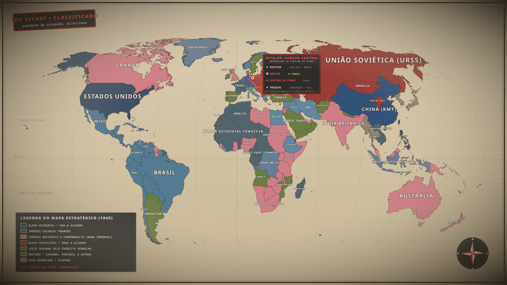

<p align="center">
  
</p>

<h1 align="center">HEGEMONY: 1945</h1>

<p align="center">
  <strong>O destino do mundo pós-guerra em suas mãos: lidere superpotências e nações soberanas através da maior disputa geopolítica da história moderna (1945–1991).</strong>
</p>

<p align="center">
  <a href="https://github.com/Rf3741/hegemony-1945/releases"></a>
  
  
  
  
  
</p>

---

> [!IMPORTANT]
> **Repositório Privado:** Este projeto e seus lançamentos oficiais encontram-se no repositório privado [`Rf3741/hegemony-1945`](https://github.com/Rf3741/hegemony-1945). Os downloads das versões pré-compiladas na aba de Releases e a clonagem do código-fonte exigem que a sua conta GitHub possua autorização expressa concedida pelo mantenedor.

---

## 🌍 O que é o jogo

Em 1º de janeiro de 1945, enquanto os canhões da Segunda Guerra Mundial ecoam os acordes finais na Europa e no Pacífico, as fundações de uma nova era geopolítica começam a ser erguidas. Das cinzas do conflito global emergem duas superpotências com visões antagônicas de civilização, modelo econômico e sociedade: os **Estados Unidos da América**, farol do capitalismo liberal de mercado, e a **União das Repúblicas Socialistas Soviéticas**, vanguarda do socialismo planejado e do bloco de leste. Entre as duas, um mosaico de impérios coloniais em declínio, novas nações em luta pela descolonização e potências regionais buscando soberania.

**HEGEMONY: 1945** é um jogo de grande estratégia histórica profunda em tempo real pausável (inspirado na densidade sistêmica de *Victoria 3* e na fluidez cartográfica de *Age of History 3*), desenvolvido nativamente em **Rust** e no motor gráfico de ponta **Bevy 0.20**.

O jogo simula a Guerra Fria em sua totalidade (1945–1991), apoiando-se em seis grandes pilares interconectados:

* 🌐 **Cartografia Planetária com 7.740 Províncias:** O globo terrestre modelado com precisão matemática em escala 10m (Natural Earth), dividido em 7.740 províncias navegáveis, estados administrativos (ADM-1) e nações soberanas, integrando relevo topográfico sombreado, brilho de costas oceânicas e ciclo dinâmico dia/noite com centros urbanos iluminados.
* 🏭 **Economia Sistêmica e Mercado Global:** Modelo macroeconômico de oferta e demanda inspirado em *Victoria 3*. Simulação contínua de indústrias, manufaturas, recursos estratégicos (petróleo, urânio, borracha, carvão), setor estatal e privado, balança de pagamentos, inflação, canais marítimos internacionais (Suez, Panamá, Bósforo) com pedágios e rotas comerciais dinâmicas.
* 🏛️ **Política Doméstica, Partidos Reais e Eleições:** Mapeamento histórico dos partidos políticos autênticos de 1945, estratos sociais e grupos de interesse demográficos. Aprove leis trabalhistas e constitucionais, enfrente coalizões e crises parlamentares, governe através de eleições disputadas ou mantenha regimes autocráticos e de partido único.
* 🤝 **Diplomacia & Esferas de Influência:** O jogo da diplomacia multilateral e bipolar. Estabeleça pactos de assistência mútua, acordos de cooperação técnica, tratados bilaterais, garantias de soberania e manobre para atrair nações não-alinhadas para a sua esfera de influência sem deflagrar a Terceira Guerra Mundial.
* 🔬 **Árvore Tecnológica & Inovação:** Desenvolvimento tecnológico em três décadas de transição crucial — da física nuclear e aviação a jato aos semicondutores, automação industrial, telecomunicações e revolução verde.
* 📰 **Eventos Históricos & Jornal Mundial:** Uma crônica viva do mundo pós-guerra. Acontecimentos históricos autênticos (Doutrina Truman, Plano Marshall, descolonização da Ásia e África, Conferências de Paz e crises regionais) disparam notícias e dilemas decisórios através do Jornal Mundial.

---

## ✨ Funcionalidades

| Pilar / Sistema | Status | Descrição |
| :--- | :---: | :--- |
| **Mapa Global de 7.740 Províncias** | 🗺️ | Globo com divisão provincial detalhada, estados, países e fronteiras históricas calibradas para 1945. |
| **Simulação Macroeconômica** | 📈 | Mercados locais e globais, precificação em tempo real de bens agrícolas e industriais, balanço de tesouro. |
| **Comércio e Canais de Trânsito** | 🚢 | Rotas comerciais marítimas e terrestres, rotas de comboio e cobrança de pedágios em canais estratégicos. |
| **Construção & Infraestrutura** | 🏗️ | Investimento em malha rodoviária, ferrovias, portos, usinas e complexos fabris em cada província. |
| **Visual Urbano e LOD Dinâmico** | 🏙️ | Cidades e metrópoles que expandem visualmente conforme a população e industrialização. |
| **Ciclo Dia / Noite em Tempo Real** | 🌓 | Alternância de iluminação com malha de luzes noturnas nas cidades ao redor do globo. |
| **Espectro Político & Partidos** | 🗳️ | Partidos reais com ideologias autênticas, bancadas de situação/oposição, eleições e legitimidade. |
| **Relações Internacionais** | 🕊️ | Painel diplomático para gerenciamento de alianças, atritos, atitudes e negociações de esferas. |
| **Árvore Tecnológica** | 🔬 | Pesquisas escalonadas com pré-requisitos históricos e bônus estruturais imediatos na produção. |
| **Jornal de Notícias Mundiais** | 📰 | Registro dinâmico de manchetes históricas e eventos geopolíticos extraordinários. |
| **Controle de Tempo Flexível** | ⏱️ | Pausa tática a qualquer instante e velocidades de simulação acelerada (1x a 5x). |
| **Paisagem Sonora de Gabinete** | 🎵 | 39 efeitos sonoros mecânicos sintetizados inspirados na estética de salas de guerra e burocracia ministerial. |

---

## 🎮 Controles

A navegação pelo globo e o gerenciamento do Estado utilizam atalhos ergonômicos e controles fluidos de mouse:

| Tecla / Entrada | Ação no Jogo |
| :---: | :--- |
| <kbd>1</kbd> | **Painel Nacional:** Resumo do governo, estabilidade, finanças e perfil demográfico |
| <kbd>2</kbd> | **Mercado Interno:** Oferta, demanda, capacidade produtiva e cotação de bens |
| <kbd>3</kbd> | **Comércio Internacional:** Rotas de importação, exportação e tarifas aduaneiras |
| <kbd>4</kbd> | **Diplomacia:** Relações exteriores, alianças, atritos e esferas de poder |
| <kbd>5</kbd> | **Árvore de Tecnologia:** Seleção de projetos de inovação civil, industrial e militar |
| <kbd>6</kbd> | **Guerra:** Frentes, exércitos, pontuação de guerra e paz (também pelo botão Guerra do HUD) |
| <kbd>7</kbd> | **Estatísticas e Ledger:** Gráficos e indicadores nacionais |
| <kbd>8</kbd> | **Enciclopédia:** Verbetes, busca e tutorial |
| <kbd>9</kbd> | **Áudio:** Volumes por canal |
| <kbd>M</kbd> / <kbd>Shift</kbd>+<kbd>M</kbd> | **Modos de Mapa:** Próximo/anterior (também pelo seletor no HUD) |
| <kbd>Ctrl</kbd>+<kbd>S</kbd> / <kbd>Ctrl</kbd>+<kbd>L</kbd> | **Salvar / Carregar** rápido |
| <kbd>B</kbd> | **Menu de Construção:** Abrir/fechar catálogo de infraestrutura e prédios |
| <kbd>V</kbd> | **Camada Visual:** Alternar visualização de malha urbana e construções (LOD) |
| <kbd>N</kbd> | **Modo Noturno:** Alternar ciclo dia/noite e iluminação das cidades |
| <kbd>J</kbd> | **Jornal Histórico:** Consultar manchetes e histórico de telegramas mundiais |
| <kbd>Espaço</kbd> | **Pausar / Retomar** o fluxo do tempo |
| <kbd>+</kbd> / <kbd>−</kbd> | **Velocidade:** Aumentar/diminuir a cadência temporal (inclui teclado numérico) |
| <kbd>Esc</kbd> | **Menu do Jogo:** Pausar e abrir menu de opções do sistema |
| <kbd>W</kbd> <kbd>A</kbd> <kbd>S</kbd> <kbd>D</kbd> / <kbd>Setas</kbd> | **Mover Câmera:** Deslocar a visão pelo mapa mundial |
| <kbd>Scroll do Mouse</kbd> | **Zoom:** Aproximar ou afastar a visualização cartográfica |
| **Arrastar (Botão Esquerdo)** | **Navegar:** Mover a visão do mapa arrastando livremente |
| **Clique (Botão Esquerdo)** | **Inspecionar:** Selecionar província e consultar dados regionais detalhados |

---

## 📦 COMO BAIXAR E JOGAR

Binários compilados e prontos para jogar são disponibilizados a cada lançamento na página de [Releases](https://github.com/Rf3741/hegemony-1945/releases).

### 💻 Requisitos de Sistema

| Componente | Requisito Mínimo Recomendado |
| :--- | :--- |
| **Sistema Operacional** | Windows 10/11 (64-bit), Linux moderno (glibc 2.31+), macOS 13+ (Ventura ou superior) |
| **Processador** | CPU Dual-Core 64-bit x86_64 ou Apple Silicon (M1/M2/M3/M4) |
| **Memória RAM** | **4 GB** de memória livre |
| **Placa de Vídeo (GPU)** | GPU compatível com **Vulkan 1.2+** (Linux/Windows), **DirectX 12** (Windows) ou **Metal** (macOS) |
| **Armazenamento** | 500 MB de espaço disponível |

---

### 🪟 Windows (x86_64)

1. Acesse a página de [Releases](https://github.com/Rf3741/hegemony-1945/releases) do repositório.
2. Baixe o arquivo `hegemony-1945-<versao>-windows-x86_64.zip`.
3. Extraia o conteúdo completo do arquivo ZIP em uma pasta à sua escolha.
4. Execute o arquivo `Hegemony-1945-<versao>.exe`.

> [!TIP]
> **Aviso do Windows SmartScreen:** Por se tratar de uma versão de distribuição direta sem certificado comercial pago da Microsoft, o Windows SmartScreen poderá exibir a janela de proteção:
> * Clique no link **"Mais informações"**.
> * Em seguida, clique no botão **"Executar assim mesmo"**.

---

### 🐧 Linux (x86_64)

1. Baixe o pacote compactado `hegemony-1945-<versao>-linux-x86_64.tar.gz` na aba de [Releases](https://github.com/Rf3741/hegemony-1945/releases).
2. Abra o terminal na pasta onde o download foi salvo e extraia o pacote:
   ```bash
   tar -xzvf hegemony-1945-*-linux-x86_64.tar.gz
   cd hegemony-1945
   ```
3. Conceda permissão de execução ao binário principal:
   ```bash
   chmod +x Hegemony-1945-*
   ```
4. Inicie o jogo:
   ```bash
   ./Hegemony-1945-*
   ```

> [!NOTE]
> **Dependências Gráficas e de Áudio no Linux:** Certifique-se de que sua distribuição possui suporte a Vulkan e ALSA instalados:
> * **Ubuntu / Debian / Pop!_OS:** `sudo apt install libasound2 libvulkan1 vulkan-tools`
> * **Arch Linux / Manjaro:** `sudo pacman -S alsa-lib vulkan-icd-loader vulkan-tools`
> * **Fedora:** `sudo dnf install alsa-lib vulkan-loader vulkan-tools`
>
> *(Uma versão empacotada em AppImage universal está planejada para lançamentos futuros, simplificando ainda mais a execução.)*

---

### 🍎 macOS (Apple Silicon & Intel)

1. Acesse as [Releases](https://github.com/Rf3741/hegemony-1945/releases) e baixe o arquivo de acordo com a arquitetura do seu Mac:
   * **Apple Silicon (M1, M2, M3, M4):** `hegemony-1945-<versao>-macos-aarch64.tar.gz`
   * **Intel Mac (x86_64):** `hegemony-1945-<versao>-macos-x86_64.tar.gz`
2. Extraia o pacote `.tar.gz` no Finder ou via terminal:
   ```bash
   tar -xzvf hegemony-1945-*-macos-*.tar.gz
   cd hegemony-1945
   chmod +x Hegemony-1945-*
   ```
3. Execute o binário `Hegemony-1945-*`.

> [!TIP]
> **Aviso do Apple Gatekeeper:** O macOS impede por padrão a inicialização de executáveis que não foram notarizados na Apple Developer Network. Para desbloquear:
> * **Via Interface:** Clique com o **botão direito** (ou pressione <kbd>Control</kbd> e clique) sobre o arquivo `Hegemony-1945-*`, selecione **"Abrir"** no menu e confirme no diálogo exibido.
> * **Via Terminal:** Execute o comando de remoção do atributo de quarentena:
>   ```bash
>   xattr -dr com.apple.quarantine Hegemony-1945-*
>   ./Hegemony-1945-*
>   ```

---

## 🛠️ Compilar do Código-Fonte

Caso deseje compilar o jogo diretamente a partir do código-fonte em Rust:

### 1. Pré-requisitos
* **Rust 1.85+** (edição estável 2024):
  ```bash
  curl --proto '=https' --tlsv1.2 -sSf https://sh.rustup.rs | sh
  rustup update stable
  ```
* No **Linux**, instale as bibliotecas de sistema exigidas pelo Bevy:
  ```bash
  # Ubuntu / Debian
  sudo apt-get install -y pkg-config libasound2-dev libudev-dev libwayland-dev libxkbcommon-dev
  ```

### 2. Comandos Principais

```bash
# Executar o jogo diretamente em modo otimizado
cargo run --release -p guerra_fria

# Executar a suíte de testes do workspace (sem exigir GPU)
cargo test --workspace --exclude guerra_fria

# Pipeline de dados geográficos (caso altere mapas do Natural Earth)
cargo run -p gerador_mapa
cargo run --release -p gerador_mapa --bin subdividir
```

Para instruções aprofundadas sobre compilação rápida com linkers modernos (`mold`/`lld`), cross-compilação Linux -> Windows (`cargo-xwin` ou `mingw`) e comandos do `justfile`/`Makefile`, consulte o [BUILD.md](BUILD.md).

---

## 🗺️ Roadmap de Desenvolvimento

O projeto segue um ciclo de expansão modular em três grandes marcos estratégicos:

```
┌────────────────────────────────────────────────────────────────────────┐
│                      HEGEMONY: 1945 - ROADMAP                          │
├───────────────────┬───────────────────────────┬────────────────────────┤
│ v1.0 (Atual)      │ v2.0 (Em Desenvolvimento) │ v3.0 (Futuro)          │
│ Economia & Estado │ Guerra & Geopolítica      │ Espaço & Era Digital   │
├───────────────────┼───────────────────────────┼────────────────────────┤
│ • 7.740 províncias│ • Conflitos convencionais │ • Corrida espacial     │
│ • Mercado global  │ • Frentes de combate din. │ • Guerra cibernética   │
│ • Rotas e pedágios│ • Generais e táticas      │ • Operações CIA x KGB  │
│ • Partidos reais  │ • Guerras por procuração  │ • Diplomacia na ONU    │
│ • Eleições e leis │ • Doutrina nuclear (MAD)  │ • Cenários 1960–1991   │
└───────────────────┴───────────────────────────┴────────────────────────┘
```

1. **v1.0 — Economia e Política (Versão Atual):**
   * Consolidação do mapa global com 7.740 províncias, províncias costeiras e iluminação de cidades.
   * Sistema macroeconômico integrado: oferta, demanda, preços dinâmicos, infraestrutura e comércio internacional com pedágio de canais.
   * Representação fidedigna dos partidos políticos históricos, grupos de interesse, processos eleitorais e jornal de eventos mundiais.
2. **v2.0 — Guerra e Conflitos Geopolíticos:**
   * Integração das unidades militares de `sim_guerra` no mapa interativo com generais e doutrinas.
   * Frentes de combate contínuas e ocupação de províncias em tempo real.
   * Guerras por procuração (*proxy wars*), envio de voluntários, casus belli e equilíbrio de dissuasão nuclear (*MAD - Mutually Assured Destruction*).
3. **v3.0 — Tecnologia Avançada, Espaço & Inteligência:**
   * Expansão da árvore científica abrangendo a Corrida Espacial (satélites, missões tripuladas e alunissagem).
   * Sistema de espionagem e operações encobertas (infiltrações diplomáticas, sabotagens industriais e golpes de estado).
   * Fórum multilateral da Organização das Nações Unidas (ONU) e resolução de crises diplomáticas globais.

---

## 🏆 Créditos e Agradecimentos

O desenvolvimento de **HEGEMONY: 1945** apoia-se em recursos de altíssima qualidade da comunidade de software livre, dados abertos e pesquisa histórica:

* **Cartografia e Geodésia:** [Natural Earth 10m](https://www.naturalearthdata.com/) — Coleção cartográfica vetorial de domínio público em escala 1:10.000.000 (linhas costeiras, fronteiras administrativas ADM-1, rios e centros urbanos).
* **Tipografia:** Fontes abertas sob licença SIL Open Font License (OFL):
  * **Barlow** (Jeremy Dooley)
  * **Oswald** (Vernon Adams)
* **Paisagem Sonora (SFX):** Efeitos sonoros proceduralmente sintetizados através de modelagem acústica e física em Python (`numpy` + `wave`), reproduzindo os sons táteis de teclas mecânicas, carimbos governamentais, alarmes e fita magnética dos gabinetes ministeriais do século XX.
* **Música Histórica:** Catálogo curado de composições orquestrais e gravações sob **Domínio Público** (incluindo gravações históricas de bandas militares sob 17 U.S.C. § 105 e acervos CC0 do *Musopen* e *Internet Archive*).
* **Tecnologias de Base:**
  * Motor de jogos [Bevy Engine](https://bevyengine.org/) (MIT / Apache-2.0)
  * Interface gráfica [bevy_egui](https://github.com/vladmarica/bevy_egui)
  * Linguagem de programação [Rust](https://www.rust-lang.org/)

---

## 📜 Licença

Este projeto é distribuído sob os termos da licença dupla:

* **Licença MIT** ([LICENSE-MIT](LICENSE-MIT) ou http://opensource.org/licenses/MIT)
* **Licença Apache 2.0** ([LICENSE-APACHE](LICENSE-APACHE) ou http://www.apache.org/licenses/LICENSE-2.0)

Você pode escolher utilizar qualquer uma das licenças a seu critério.
